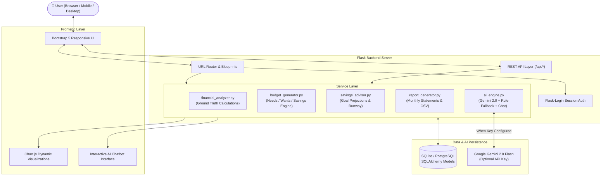
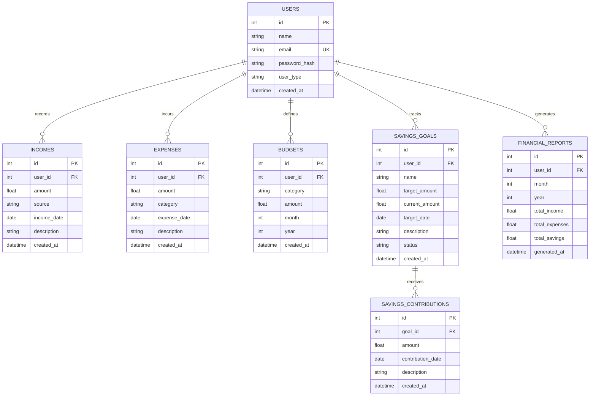

# Personal Finance Advisor Bot ("FinanceBot") 💰🤖
> **Smart money management, made simple.**  
> *A full-stack, AI-powered personal financial management and budgeting platform built for college/internship capstone evaluation.*

[](https://www.python.org/)
[](https://flask.palletsprojects.com/)
[](https://www.sqlite.org/)
[](https://www.postgresql.org/)
[](https://ai.google.dev/)
[](https://pytest.org/)
[](LICENSE)

---

## 1. Project Overview

**Personal Finance Advisor Bot** is a modern, responsive full-stack web application designed to help individuals track income, log daily expenses, monitor category budgets, progress toward savings targets, and receive personalized financial advice.

The application combines deterministic Python arithmetic (ensuring zero math hallucinations) with an AI Advisor Engine that integrates **Google Gemini 2.0 Flash** when an API key is provided, while seamlessly falling back to a rule-based advisory engine when offline or without an API key.

---

## 2. Problem Statement

Many students, salaried professionals, freelancers, and household managers struggle to maintain consistent financial discipline due to:
* **Fragmented tracking**: Receipts, bank statements, and notes scattered across apps.
* **Lack of actionable insights**: Spreadsheets display raw figures without explaining *where* or *why* overspending occurs.
* **Complex financial software**: Commercial software often demands complex bank linking, paid subscriptions, or displays overwhelming investment jargon.
* **One-size-fits-all budgeting**: Generic advice fails to account for the volatile cash flows of freelancers or the limited allowances of students.

**FinanceBot** addresses these challenges by offering a clean, user-friendly interface with automated budget generation, interactive AI chat assistance, persona-aware advice, and measurable financial health indicators.

---

## 3. Project Objectives

1. **User Authentication & Privacy**: Secure user registration, password hashing (PBKDF2/Werkzeug), and complete multi-tenant database isolation.
2. **Income & Expense Tracking**: Easy logging, categorization, editing, and deletion of incomes and expenses with real-time filtering and search.
3. **Intelligent Budget Generator**: Dynamic budget recommendation engine based on monthly income, user persona, and spending history.
4. **Savings Goals & Deadline Forecasting**: Target amount tracking with progress bars and monthly required deposit calculations.
5. **Interactive AI Chat & Advisory**: Context-aware chatbot answering queries like *"How much did I spend this month?"*, *"Where am I overspending?"*, and *"Give me a budget for next month."*
6. **Personal Financial Health Overview**: Transparent evaluation of Savings Rate, Budget Adherence, Expense Burden, and Goal Progress.
7. **Monthly Financial Reporting**: Comprehensive monthly statements with executive summaries, top categories, budget variance, and downloadable CSV exports.
8. **Special User Scenarios**: Tailored budgeting rules for Salaried Professionals, College Students, Freelancers, and Household Managers.

---

## 4. Key Features

* 📊 **Dynamic Dashboard**: 4 key metric cards (Total Income, Total Expenses, Net Savings, Savings Rate), Remaining Budget, Top Spending Category, and 4 interactive Chart.js visualizations.
* 💳 **Income & Expense Management**: Date, category/source, description, and amount with live search and "High Outflow" visual flags for unusually large transactions.
* 🎯 **Smart Budget Generator**: Recommends category allocations based on user persona and historical patterns, separating Needs, Wants, and Savings pools.
* 🐷 **Savings Goals Tracker**: Calculates runway months and monthly required savings to hit deadlines on time.
* 🤖 **Dual-Engine AI Advisor**:
  * **Gemini 2.0 Flash Mode**: Deep qualitative analysis when `GEMINI_API_KEY` is provided.
  * **Smart Rule-Based Fallback**: Deterministic heuristic engine ensuring the app is 100% operational without an external key.
* 💬 **Interactive AI Chatbot**: In-app conversational interface with quick-prompt buttons for instant financial queries.
* 📑 **Comprehensive Monthly Reports**: Detailed view of monthly performance with one-click CSV report export.
* 🛡️ **Role-Based Personas**: Pre-configured setups for Salaried Professionals, College Students, Freelancers, and Household Managers.

---

## 5. Technology Stack

### Backend
* **Python 3.11**
* **Flask 3.0+**: Lightweight, scalable WSGI web framework
* **SQLAlchemy & Flask-SQLAlchemy**: Robust ORM with foreign keys and cascade deletions
* **Flask-Login**: Secure session authentication and unauthorized access protection
* **Werkzeug Security**: Cryptographic password hashing (`generate_password_hash`, `check_password_hash`)
* **SQLite**: Default zero-configuration database (PostgreSQL-ready via `DATABASE_URL`)

### Frontend
* **HTML5 & CSS3**
* **Bootstrap 5.3.3**: Modern, mobile-responsive grid system and UI components
* **Bootstrap Icons & Font Awesome 6**: Intuitive icon sets
* **Chart.js 4.4**: Interactive financial charts (Bar, Doughnut, Line)
* **Marked.js**: Clean Markdown rendering for AI responses

### AI & Advisory Engine
* **Google Gemini API (`gemini-2.0-flash`)**: High-speed, structured generative financial suggestions
* **Local Deterministic Fallback Engine**: Rule-based heuristic pattern matcher and budgeting advisor

---

## 6. System Architecture



---

## 7. Database Design



---

## 8. Project Structure

```
personal-finance-advisor/
│
├── app.py                      # Main application server runner
├── config.py                   # App configuration (dev, test, prod, database)
├── seed_data.py                # Database seeder with 4 persona demonstration datasets
├── requirements.txt            # Python dependencies
├── README.md                   # Complete project documentation
├── .env.example                # Template for environment variables
├── .gitignore                  # Git ignore rules
│
├── models/                     # SQLAlchemy Database Models
│   ├── __init__.py             # Exports db, enums, and models
│   ├── user.py                 # User authentication model
│   ├── income.py               # Income transaction model
│   ├── expense.py              # Expense transaction model
│   ├── budget.py               # Category monthly budget model
│   ├── savings_goal.py         # Savings goal & contribution models
│   └── financial_report.py     # Monthly financial report snapshot model
│
├── routes/                     # Blueprint Route Handlers
│   ├── __init__.py             # Blueprint exports
│   ├── auth.py                 # Register, login, logout routes
│   ├── dashboard.py            # Financial dashboard & charts data routes
│   ├── income.py               # Income CRUD routes
│   ├── expenses.py             # Expense CRUD and search routes
│   ├── budgets.py              # Budget management & auto-generator routes
│   ├── savings.py              # Savings goal tracking & contribution routes
│   ├── reports.py              # Monthly reports & CSV download routes
│   └── advisor.py              # AI Advisor & interactive chatbot routes
│
├── services/                   # Business Logic & Calculation Engines
│   ├── __init__.py             # Service package exports
│   ├── financial_analyzer.py   # Ground-truth arithmetic & health indicators
│   ├── budget_generator.py     # Intelligent Needs/Wants/Savings budget creator
│   ├── savings_advisor.py      # Goal forecasting & emergency runway analysis
│   ├── report_generator.py     # Monthly statement compilation & CSV export
│   └── ai_engine.py            # Gemini 2.0 Flash, local rule engine & chat query engine
│
├── templates/                  # Jinja2 HTML5 Templates
│   ├── base.html               # Shared layout, navbar, footer & scripts
│   ├── login.html              # Secure login page
│   ├── register.html           # New user registration page
│   ├── dashboard.html          # Financial dashboard with 4 Chart.js charts
│   ├── income.html             # Income management page
│   ├── expenses.html           # Expense management & search page
│   ├── budgets.html            # Category budget manager & auto-generator
│   ├── savings.html            # Savings goals & progress page
│   ├── reports.html            # Monthly statement & report view
│   └── advisor.html            # AI Advisor & interactive Chatbot UI
│
├── static/                     # Static Assets
│   ├── css/
│   │   └── style.css           # Modern custom stylesheet
│   ├── js/
│   │   ├── dashboard.js        # Chart.js initialization & dynamic updates
│   │   ├── expenses.js         # Client validation & search utilities
│   │   ├── charts.js           # Reusable Chart.js helper library
│   │   └── main.js             # General interactive client scripts
│   └── images/                 # Project assets and placeholders
│
├── tests/                      # Automated Test Suite (pytest)
│   ├── conftest.py             # Test fixtures & test clients
│   ├── test_auth.py            # User authentication tests
│   ├── test_income.py          # Income CRUD tests
│   ├── test_expenses.py        # Expense CRUD & search tests
│   ├── test_budget.py          # Budget logic tests
│   ├── test_savings.py         # Savings goal tests
│   ├── test_reports.py         # Report generation tests
│   ├── test_security.py        # Multi-user data isolation tests
│   ├── test_ai_routes.py       # AI parsing & fallback tests
│   └── test_api_endpoints.py   # Full REST API test suite
│
└── instance/
    └── finance.db              # SQLite development database
```

---

## 9. Installation & Setup

### Prerequisites
* **Python 3.10+** (Tested on Python 3.11.9)
* **pip** (Python package installer)
* **Git**

### Step 1: Clone the Repository
```bash
git clone https://github.com/your-username/personal-finance-advisor.git
cd personal-finance-advisor
```

### Step 2: Create and Activate Virtual Environment
**Windows (PowerShell / Command Prompt):**
```powershell
python -m venv venv
venv\Scripts\activate
```

**macOS / Linux:**
```bash
python3 -m venv venv
source venv/bin/activate
```

### Step 3: Install Dependencies
```bash
pip install -r requirements.txt
```

### Step 4: Configure Environment Variables
Copy the example `.env` file:
```bash
copy .env.example .env     # Windows
cp .env.example .env       # macOS / Linux
```
*(Optional)* Add your Google Gemini API key to `.env` from [Google AI Studio](https://aistudio.google.com/):
```env
GEMINI_API_KEY=your_gemini_api_key_here
```
> **Note:** If no API key is provided, the application automatically runs using the local rule-based advisor engine without crashing!

### Step 5: Seed Demonstration Data
Populate the database with sample transactions, budgets, goals, and reports for all 4 user personas:
```bash
python seed_data.py
```

### Step 6: Run the Application
```bash
python app.py
```

Open your web browser and navigate to:  
👉 **http://127.0.0.1:5000**

---

## 10. Demo User Accounts

The seed script creates 4 distinct demonstration personas to showcase the system during college or internship evaluations:

| Persona | Email | Password | Monthly Income | Key Tracking Focus |
|---|---|---|---|---|
| **Salaried Professional** | `salaried@example.com`<br>*(or `demo@example.com` / `Demo@12345`)* | `Password123` | ₹65,000 | Rent, groceries, transport, 20% savings target |
| **College Student** | `student@example.com` | `Password123` | ₹15,000 | Allowance, campus food, textbooks, cert exam goal |
| **Freelancer** | `freelancer@example.com` | `Password123` | ₹75,000 *(varies)* | Volatile invoices, 9-month emergency runway |
| **Household Manager** | `household@example.com` | `Password123` | ₹85,000 | Family groceries, utilities, school fees, domestic expenses |

---

## 11. REST API Reference

All API endpoints return standard JSON responses and support both session authentication and JSON payloads.

| Method | Endpoint | Description |
|---|---|---|
| `POST` | `/api/register` | Register a new user account |
| `POST` | `/api/login` | Authenticate user and initiate session |
| `POST` | `/api/logout` | Terminate user session |
| `GET` | `/api/dashboard` | Fetch consolidated financial summary and chart data |
| `GET` | `/api/income` | List user income entries (filters: `month`, `year`, `source`) |
| `POST` | `/api/income` | Create new income record |
| `PUT` | `/api/income/<id>` | Update existing income record |
| `DELETE` | `/api/income/<id>` | Delete income record |
| `GET` | `/api/expenses` | List expenses (filters: `month`, `year`, `category`, `search`) |
| `POST` | `/api/expenses` | Create new expense entry |
| `PUT` | `/api/expenses/<id>` | Update existing expense entry |
| `DELETE` | `/api/expenses/<id>` | Delete expense entry |
| `GET` | `/api/budgets` | Fetch monthly budgets with utilization metrics |
| `POST` | `/api/budgets` | Create or update category budget limit |
| `PUT` | `/api/budgets/<id>` | Update budget limit |
| `DELETE` | `/api/budgets/<id>` | Delete budget limit |
| `GET` | `/api/savings-goals` | List savings goals with progress and monthly required |
| `POST` | `/api/savings-goals` | Create a new savings goal |
| `PUT` | `/api/savings-goals/<id>` | Update savings goal |
| `DELETE` | `/api/savings-goals/<id>` | Delete savings goal |
| `GET` | `/api/reports/<year>/<month>` | Fetch monthly financial report snapshot |
| `POST` | `/api/advisor/analyze` | Request full structured AI advisory analysis |
| `POST` | `/api/advisor/chat` | Query the interactive AI financial chatbot |

---

## 12. Financial Calculations & Formulas

* **Net Savings**:
  $$\text{Savings} = \text{Total Income} - \text{Total Expenses}$$

* **Savings Rate**:
  $$\text{Savings Rate} = \left(\frac{\text{Savings}}{\text{Total Income}}\right) \times 100$$

* **Expense Ratio**:
  $$\text{Expense Ratio} = \left(\frac{\text{Total Expenses}}{\text{Total Income}}\right) \times 100$$

* **Remaining Budget**:
  $$\text{Remaining Budget} = \text{Budget Limit} - \text{Actual Category Spending}$$

* **Goal Progress**:
  $$\text{Goal Progress (\%)} = \min\left(100.0, \frac{\text{Current Saved}}{\text{Target Amount}} \times 100\right)$$

* **Monthly Required Savings**:
  $$\text{Monthly Required} = \frac{\text{Target Amount} - \text{Current Saved}}{\max(1, \text{Months Remaining})}$$

*(All calculations include zero-division guards and negative income checks).*

---

## 13. Screenshots Section

> *Place project UI screenshots in `static/images/` and link them here:*

* **Dashboard View**: `static/images/screenshot_dashboard.png` *(Key stats, 4 Chart.js visualizations, health overview)*
* **Income Management**: `static/images/screenshot_income.png` *(Income list, source breakdown, add/edit modal)*
* **Expense Management**: `static/images/screenshot_expenses.png` *(Categorized expenses, search bar, high outflow badges)*
* **AI Advisor & Chatbot**: `static/images/screenshot_advisor.png` *(Interactive chatbot interface with starter questions)*
* **Monthly Report**: `static/images/screenshot_reports.png` *(Statement summary, budget variance, CSV export)*

---

## 14. Testing & Verification

The project includes an automated test suite executed with `pytest`:
```bash
python -m pytest tests/ -v
```

### Test Results:
* **49 Passed Unit & Integration Tests**:
  * `test_auth.py`: Registration, password hashing, login, logout, duplicate emails.
  * `test_income.py`: Income creation, updates, deletions, positive amount validation.
  * `test_expenses.py`: Expense creation, category assignment, date filtering, search.
  * `test_budget.py`: Budget limits, over-budget calculations, adherence scores.
  * `test_savings.py`: Goal progress, months remaining, contribution deposits.
  * `test_reports.py`: Monthly report consolidation and CSV text generation.
  * `test_security.py`: Rigorous tenant isolation ensuring User A cannot read or modify User B's records.
  * `test_ai_routes.py`: Gemini prompt construction, JSON extraction, and rule fallbacks.
  * `test_api_endpoints.py`: Complete REST API endpoints testing with JSON payloads.

---

## 15. Future Enhancements

* 🔮 **Predictive Spending Analytics**: Machine learning models for next-month expense forecasting.
* 📱 **Native Mobile Application**: Cross-platform Flutter / React Native client.
* 📄 **Automated Statement Parser**: Direct PDF/CSV bank and UPI statement ingestion.
* 🔔 **Smart Notifications**: Push and email reminders when approaching 90% of a category budget.
* 📈 **Investment Education Simulator**: Risk-free SIP and compounding growth calculators.

---

## 16. Author

* **Developer:** Pranjal Gaikwad
* **Project Type:** Internship Capstone Project
* **Institution / Track:** Computer Science & Full-Stack Web Development
* **Advisor System:** Personal Finance Advisor Bot (“FinanceBot”)

---

## 17. License

This project is licensed under the MIT License — see the [LICENSE](LICENSE) file for details.
